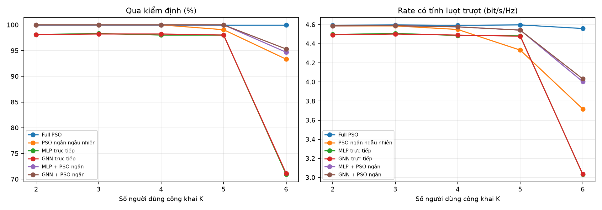

# Multiuser Active RIS–NOMA Covert Communication

Research code and reproducible benchmark records for power allocation with one covert receiver, multiple public receivers, active-RIS noise, hardware distortion, public-rate constraints, Bob's SIC/outage constraint, and a minimum detection-error requirement at Willie.

The main experiment is the six-method benchmark in `experiments/ris_noma_step1/step7h/`. The repository retains the complete development and final-test output directories, including the input snapshots and selected checkpoints needed to verify the saved results and rerun the final comparison.

## Experimental scope

- GNN and pooled MLP are trained on K=2, 3, 4, 5 public users, using 32 training layouts and a separate 16-layout validation set.
- The final test uses 40 new layouts, IDs 5000–5039, with eight power/DEP cases per layout and three paired seed replicates.
- K=2–5 is the test within the trained user-count range. K=6 is an unseen user count and is reported separately. K=6 has 960 allocation trials per method, not a single test scenario.
- The six methods are Full PSO, random short PSO, direct pooled MLP, direct GNN, MLP + short PSO, and GNN + short PSO.
- Full PSO uses 1,800 objective evaluations; the validation-selected short budget is 150. The counts include the initial 30-particle population, giving 59 and 4 updates respectively. Each budget has its own complete inertia schedule.
- RIS has 32 ULA elements, Rician factor 1, and hardware-distortion coefficient 0.1. The public-user count K is distinct from the Rician factor. The adopted scalar RIS-noise model and Bob-aligned phase rule are retained.

Passed percentages are physical feasibility-assessment rates, not accuracy against PSO labels. Failed allocations contribute zero to the gated-rate average and remain in its denominator. Full PSO is a large-budget numerical reference, not a global-optimality proof.

## Contents

| Path | Purpose |
|---|---|
| `experiments/ris_noma_step1/` | Source, configurations, dependencies and tests |
| `results/step7h_development32/` | Complete validation comparison, fixed budget selection, diagnostic folds, protocol and model/input snapshots |
| `results/step7h_test40/` | Complete final-test records, physical rows, figures, six checkpoints and independent-assessment evidence |
| `results/step7h_test40/inputs/train.jsonl` | Original 32-layout training graph/label input snapshot |
| `results/step7h_test40/inputs/validation.jsonl` | Separate validation graph/label input snapshot |
| `results/step7h_test40/inputs/` | Corpus, training, geometry and physical configuration snapshots |
| `results/step7h_test40/models/` | Six selected deployment checkpoints |

Keep `inputs`, `models`, `search`, `audit`, `source_snapshot`, the development `cv` directory, receipt files and completion manifests. The checker uses these records together. Copying only the summary CSV files does not produce a complete reproducible output.

## Clone the repository

Copy the repository's HTTPS URL from the GitHub **Code** button, then replace the placeholder below:

```bash
git clone "PASTE_THE_REPOSITORY_HTTPS_URL_HERE" active-ris-noma-covert
cd active-ris-noma-covert
```

If the repository is private, use a GitHub account that has been granted access. All following commands assume the repository root unless a different working directory is stated. The code does not require the author's `G:` drive or Python environment.

## Environment

Python 3.12 and the CPU backend are the reference setup. On Windows PowerShell, from the repository root:

```powershell
python -m venv .venv
$pyRepo = (Resolve-Path .\.venv\Scripts\python.exe).Path
& $pyRepo -m pip install "torch==2.15.0" --index-url https://download.pytorch.org/whl/cpu
& $pyRepo -m pip install -r experiments/ris_noma_step1/requirements_step7h.txt
```

On Linux:

```bash
python3 -m venv .venv
.venv/bin/python -m pip install 'torch==2.15.0' --index-url https://download.pytorch.org/whl/cpu
.venv/bin/python -m pip install -r experiments/ris_noma_step1/requirements_step7h.txt
```

The recorded Windows environment uses Python 3.12.7, NumPy 2.5.4, SciPy 1.18.1, Matplotlib 3.11.2, PyTorch 2.15.0+cpu and filelock 3.32.7. The source requirements declare supported ranges. The original version metadata is preserved in the result plans. Runtime and small floating-point differences can depend on the environment; compare feasibility and numerical results separately from timing.

## Verify the complete saved experiment

These commands check the committed evidence without performing the PSO searches again. From the repository root in PowerShell:

```powershell
Push-Location experiments/ris_noma_step1
& $pyRepo -X utf8 run_step7h.py check --output "..\..\results\step7h_development32"
& $pyRepo -X utf8 run_step7h.py check --output "..\..\results\step7h_test40"
Pop-Location
```

Both commands must report `"complete": true`. The final check covers all six methods, 40 layouts, 200 layout/K groups and 28,800 physical rows. It verifies source/checkpoint hashes, train/validation separation, normalization lineage, evaluation counts, search/audit commitments, saved statistical decisions and aggregate consistency. It is a consistency audit of the recorded study, not a proof that overfitting is impossible.

On Linux, from the repository root:

```bash
cd experiments/ris_noma_step1
../../.venv/bin/python run_step7h.py check --output ../../results/step7h_development32
../../.venv/bin/python run_step7h.py check --output ../../results/step7h_test40
cd ../..
```

## Rerun the final K=2–5 / K=6 comparison

The saved development protocol and its full supporting records are sufficient to launch the original final-test runner. A new label-generation or main-model training run is not required.

```powershell
Push-Location experiments/ris_noma_step1
& $pyRepo -X utf8 run_step7h.py test --protocol "..\..\results\step7h_development32\protocol.json" --output "..\..\results\step7h_reproduced" --workers 2
& $pyRepo -X utf8 run_step7h.py check --output "..\..\results\step7h_reproduced"
Pop-Location
```

This reruns the 40-layout comparison with six methods for K=2–6, using the original selected checkpoints and parameter schedule. It performs 10.8 million objective evaluations and the corresponding independent fading assessments, so it is a substantial CPU experiment. It is a rerun of the already observed test, not a newly untouched holdout.

Use a fresh output directory. If the same run was interrupted, repeat the `test` command with `--resume`, keeping the same protocol, worker count and environment. Do not use the original result directory as the output of a new run. New output directories are ignored by Git until explicitly selected for publication.

## Tests

From PowerShell at the repository root:

```powershell
Push-Location experiments/ris_noma_step1
& $pyRepo -X utf8 -m unittest discover -s tests_step7h -v
& $pyRepo -X utf8 -m unittest discover -s tests -p test_pso.py -v
& $pyRepo -X utf8 -m unittest discover -s tests -p test_dep.py -v
Pop-Location
```

## Source map

The paths below are relative to `experiments/ris_noma_step1/`.

| Component | File |
|---|---|
| Main command-line entry | `run_step7h.py` |
| Development, protocol sealing and final rerun | `step7h/driver.py` |
| Six-method search, initialization and independent audit | `step7h/benchmark.py` |
| Role-specific channel streams and allocation correction | `step7h/physics.py` |
| Verification of the saved study | `step7h/checks.py` |
| Summaries, paired comparisons and layout-cluster bootstrap | `step7h/analysis.py` |
| Standard optimizer and feasible-first comparator | `step7h/frozen_runtime/ris_noma/pso.py` |
| Allocation decoder and cached physical objective | `step7h/frozen_runtime/ris_noma/multik_core.py` |
| Search margins | `step7h/frozen_runtime/ris_noma/continuous_data.py` |
| Channel generation and geometric LoS | `step7h/frozen_runtime/ris_noma/channels.py`, `geometry_los.py` |
| SINR, SIC, rate, outage and assessment | `step7h/frozen_runtime/ris_noma/stable_assessment.py` |
| Gamma/empirical detection error | `step7h/frozen_runtime/ris_noma/dep.py` |
| Finite-sample assessment bounds | `step7h/frozen_runtime/ris_noma/validation.py` |
| Models and supervised training | `step7h/frozen_runtime/ris_noma/curve_models.py`, `curve_fit.py`, `multik_models.py`, `multik_learning_models.py` |

## Further development and alternative optimizers

Use `main` for the reviewed reference and `develop` for ongoing work. For an optimizer experiment:

```bash
git switch develop
git switch -c feature/qpso
```

After making and testing a change, review and publish the branch:

```bash
git status --short
git add .
git diff --cached --stat
git commit -m "Add experimental optimizer changes"
git push -u origin feature/qpso
```

Open a pull request when the change is ready for review. The reviewed `main` branch remains the reference for the recorded study. If a new result directory should be published, explicitly allow that directory in `.gitignore` and review its contents before committing.

QPSO is not implemented in the reference. An alternative optimizer can reuse the allocation decoder, physical objective and independent assessment. A candidate has K+1 normalized coordinates in [0,1]; the objective returns `Outcome(score, violation, feasible, metrics)`. The standard implementation uses `better` to prefer feasibility, then maximize rate, and otherwise minimize normalized violations. Count every objective call, including initialization and auxiliary trials.

The archived runtime and sealed protocol identify the exact code associated with the original results. Keep that reference intact. Add an experimental module/runner or create a separately named runtime and protocol for a changed algorithm. A hash mismatch indicates that the code no longer matches the original sealed protocol; use a new experimental plan and output for a changed method.

For fair comparisons, declare scenario/layout lists, evaluation budgets, random streams, margins, checkpoint policy and assessment rules before examining new test results. Reuse the same search inputs for paired methods and keep the assessment bank separate from optimization.

The included training and validation snapshots contain graph inputs and labels used by the selected models. The repository does not include the entire historical label-generation corpus, every previous learning-curve stage or all 7g diagnostic artifacts. Repeating all earlier development stages through their original command-line interfaces requires those additional data packages. They are not needed for the saved checks and final benchmark rerun above.

## Read the results

Start with `results/step7h_test40/metrics.csv`, `pso_metrics.csv`, `direct_metrics.csv`, `by_k.csv`, `by_cv.csv` and `paired_contrasts.csv`. Detailed physical rows and failure rows are retained for inspection.



The results support conclusions within the stated channel, layout, SIC and detector assumptions. GNN and MLP are close within the trained K range; extrapolation to K=6 still has a gap to Full PSO. High feasibility on the observed cases is not a guarantee for every future layout.

The inherited active-RIS model is described by P. Chen et al., *Active RIS-NOMA-Aided Covert Communication With Hardware Impairments*, IEEE Wireless Communications Letters, 2023.
